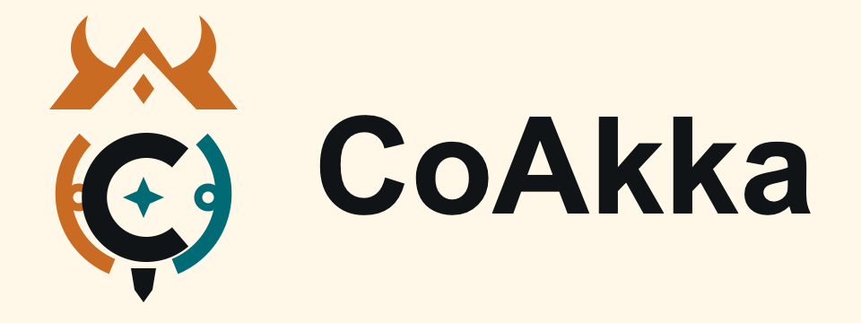
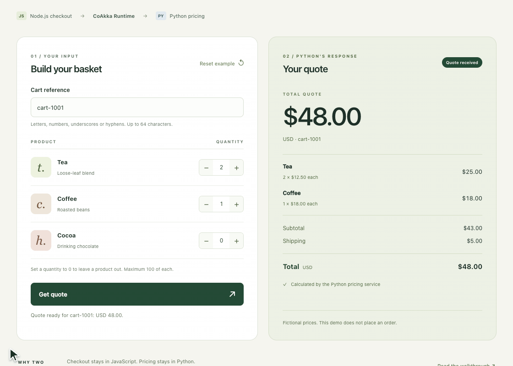

# CoAkka Samples

[Website](https://coakka-ecosystem-preview.vivid-plume-2955.chatgpt.site/) · [Get started](#choose-what-you-want-to-build) · [Documentation](docs/README.md) · **[coakka-http-runtime-test](https://github.com/phuong-tran/coakka-publish/tree/main/coakka-http-runtime/runtime-test)** · [coakka-runtime-test](https://github.com/phuong-tran/coakka-publish/tree/main/coakka-runtime/runtime-test) · [HTTP Benchmarks (Pi 5)](https://github.com/phuong-tran/coakka-publish/blob/main/coakka-http-runtime/benchmark/README.md)

**Contents**

[Choose a product](#choose-what-you-want-to-build) · [CoAkka Runtime](#coakka-runtime-languages-frameworks-and-app-hosts) · **[CoAkka HTTP Runtime](#coakka-http-runtime-shared-http-familiar-languages)** · [HTTP Inspect](#coakka-http-runtime-inspect) · [Runtime addons](#coakka-runtime-addons) · [Runtime Client / Inspect](#coakka-runtime-client-and-inspect) · [Node–Python demo](#try-the-nodepython-web-demo)

**Shared native cores. Familiar APIs across languages.**

CoAkka is a **polyglot, cross-platform ecosystem** built on shared native cores.
**CoAkka Runtime** is a **native-backed distributed runtime for
application-owned work**: for example, a Node.js checkout asking Python to
calculate a price. Your application keeps its handlers, business rules and data;
Runtime carries the request and reply across languages, processes and hosts.

Use **HTTP Runtime** for HTTP services and **Logger** for logging with bounded
storage. Each product can be adopted independently and has its own packages
and versions.

**[Choose your language and run your first example](#choose-what-you-want-to-build)**

## Try the Node–Python web demo

Build a basket in your browser. Node.js sends it to a separate Python process,
which returns item prices, shipping and the total through CoAkka Runtime.

**[Run the demo and read the walkthrough](coakka-runtime/scenarios/order-quote-node-python/README.md)** · Published npm/PyPI **3.0.0** packages · Two terminals, no Docker required.

Change the quantities, request a quote and see Python return the updated total.
[View a still screenshot](docs/coakka-runtime/assets/node-python-order-quote-web.png).

## Choose what you want to build

| I want to… | Product | Start here |
| --- | --- | --- |
| Call named application work across languages or processes | CoAkka Runtime | [Choose my language and run one example](docs/coakka-runtime/getting-started.md) |
| Build an HTTP API, web frontend or streaming endpoint | CoAkka HTTP Runtime | [Choose my HTTP language guide](docs/coakka-http-runtime/getting-started.md) |
| Record logs and see pressure when output falls behind | CoAkka Logger | [Choose my Logger example](docs/coakka-logger/README.md#start-with-one-consumer) |

## CoAkka Runtime: languages, frameworks and app hosts

CoAkka Runtime brings application-owned work to backend, desktop and device
applications through three complementary lanes:

### Message-Lane, File-Lane and Stream-Lane

| What your application needs | Runtime lane | Learn more |
| --- | --- | --- |
| Send commands, ask for results or publish events | **Message-Lane** | [Requests, replies and routing](docs/coakka-runtime/explanation/runtime-message-and-routing-model.md) |
| Move a stable file that already exists on the sending host | **File-Lane** | [File transfer](docs/coakka-runtime/guides/runtime-file-transfer.md) |
| Send live frames as they are produced, such as camera, audio or telemetry | **Stream-Lane** | [Streaming](docs/coakka-runtime/guides/runtime-streaming.md) |

Choose the integration that matches your code:

| Application language or host | Start here |
| --- | --- |
| JavaScript / TypeScript on Node.js and Bun; Python; Java and Kotlin; C#; Go; Swift | [Language-first Runtime examples](coakka-runtime/README.md#first-run-choose-your-language) |
| Spring Boot and Quarkus | [Framework customer applications](coakka-runtime/scenarios/customer-crud/framework-registry/README.md) |
| Electron and Tauri desktop apps | [Electron](coakka-runtime/electron/registry-basic/README.md) · [Tauri](coakka-runtime/tauri/README.md) |
| C / C++, Rust, Zig, Android and Mojo | [Source/archive guides and previews](coakka-runtime/README.md#other-languages-and-evaluations) |

Start with the **3.0.0** language examples. Tauri, C/C++, Rust and Zig use their
own versioned source/archive guides; Android and Mojo are previews. Follow each
guide's package, lane and platform scope.

### Core and connector versions

Read a connector version such as `3.1.1` as Core generation `3.1`
and connector revision `1`, the connector's first release on that Core.
A connector fix can advance its own revision to `3.1.2` while using the
same Core SDK and native checksums. When the connector adopts Core `3.2`,
its first release on that generation is `3.2.1`.

On npm, Node.js and Bun `3.1.2` and Electron `3.1.1` use Core 3.1 r2.
Electron installs Node.js `3.1.2` as its exact dependency.
See the [current package versions](docs/common/current-packages.md).

## CoAkka Runtime addons

**Artifact Source Addons** acquire and verify an exact model file from
**S3/MinIO**, **Hugging Face Hub**
or another provider, then deliver it through **File-Lane**. Already have a stable
local file? Use File-Lane directly.

**Native C is the maintained addon interface.** Other language bindings depend
on concrete user demand. Addons keep their own versions and platform scope;
check [Runtime 3.0.0 compatibility](docs/coakka-runtime/guides/native-addons-runtime3.md)
before selecting one.

[Understand the workflow](docs/coakka-runtime/guides/runtime-addons.md) ·
[Choose a provider example](coakka-runtime/addons/README.md) ·
[Package and compatibility catalog](https://github.com/phuong-tran/coakka-publish/blob/main/runtime-addons/README.md).

## CoAkka Runtime Client and Inspect

Try requests before writing another application, or inspect a request during
integration. Product names and released commands are listed separately:

| Product | Released command | Use it for |
| --- | --- | --- |
| [CoAkka Runtime Client](docs/coakka-runtime/operations/coakka-runtime-client.md) | `coakka-client` | Send requests from a terminal or script and inspect the result. |
| [CoAkka Runtime Inspect](docs/coakka-runtime/operations/coakka-runtime-inspect.md) | `coakka-runtime-inspect` | Explore Runtime facts and try request/reply in a browser. |

Each guide records the tool's version, connection setup and inspection scope.

## CoAkka HTTP Runtime: shared HTTP, familiar languages

**CoAkka HTTP Runtime** (`coakka-http-runtime`) provides a shared native HTTP
core for **polyglot HTTP servers and outbound HTTP requests**. Build APIs, web
frontends, uploads, file delivery, streaming and WebSocket services.

Language packages share HTTP behavior and fixes while handlers stay in your
language. An HTTP handler can ask CoAkka Runtime to perform named work; each
product can also be used independently.

Outbound requests are part of HTTP Runtime's documented package scope. The
planned standalone **CoAkka HTTP Client** is a separate future product:
[current client scope and roadmap](docs/coakka-http-runtime/explanation/introduction.md#outbound-http-and-the-planned-http-client).

**HTTP Runtime 2.0.1** is available for Node.js and Bun on npm, Python on PyPI,
Go through the `/v2` module, and Java and Kotlin through Maven Central.

The first two numbers identify the Core generation; the last identifies that
connector's revision on that Core. For example, `2.0.1` is revision 1 on Core
`2.0`. If Go alone publishes `2.0.2`, it still uses Core `2.0` and the same
native SDK. See [how to read HTTP Runtime versions](https://github.com/phuong-tran/coakka-publish/blob/main/coakka-http-runtime/docs/versions.md)
and [run your first HTTP request](docs/coakka-http-runtime/getting-started.md).

### CoAkka HTTP Runtime Inspect

**Swagger-like exploration: browse routes, try HTTP requests and export
OpenAPI 3.0.3.** Inspect has its own browser UI and works with a service that
explicitly enables inspection.

Current Inspect archives cover **macOS ARM64** and **Linux ARM64**. Language APIs
for declaring route/schema metadata are still being completed; check the
integration status below before adding Inspect to an example.

[Walkthrough](https://github.com/phuong-tran/coakka-publish/blob/main/coakka-http-runtime/inspect/walkthrough.md) · [Explore Inspect and OpenAPI](https://github.com/phuong-tran/coakka-publish/blob/main/docs/coakka-http-runtime/inspect/metadata-and-openapi.md) ·
[Current integration status](https://github.com/phuong-tran/coakka-publish/blob/main/docs/coakka-http-runtime/inspect/metadata-and-openapi.md#current-package-integration) ·
[Inspect packages and setup](https://github.com/phuong-tran/coakka-publish/blob/main/coakka-http-runtime/inspect/README.md).

## First time here?

1. Choose one product and your language above.
2. Follow that guide's prerequisites, run command and expected result.
3. Read its application source, then [choose a Runtime use case](docs/coakka-runtime/guides/examples-and-use-cases.md)
   or the selected product's next example.

## Explore further

- [New to CoAkka](docs/common/new-to-coakka.md) explains the products and the application model.
- [Documentation](docs/README.md) leads to integration, operation and reference.
- [All Runtime examples](coakka-runtime/README.md), [HTTP examples](coakka-http-runtime/README.md)
  and [Logger examples](coakka-logger/README.md) show their own language coverage.
- [Current packages](docs/common/current-packages.md) records released versions.
- [Troubleshooting](docs/coakka-runtime/operations/troubleshooting.md) helps with Runtime setup.

Repository helpers: run bash run.sh list to list examples, or bash run.sh doctor
to inspect prerequisites. You only need the tools for the example you choose.

Samples is a rolling repository. Follow each example's declared dependencies;
versioned source mirrors retain their original content.
[Publish](https://github.com/phuong-tran/coakka-publish) hosts package catalogs
and versioned downloads. [Product layout](docs/common/product-layout.md) explains the repository map.

[Contributing](CONTRIBUTING.md) · [Support](SUPPORT.md) · [Changelog](CHANGELOG.md)

Contact: gabrielgun1983@gmail.com
