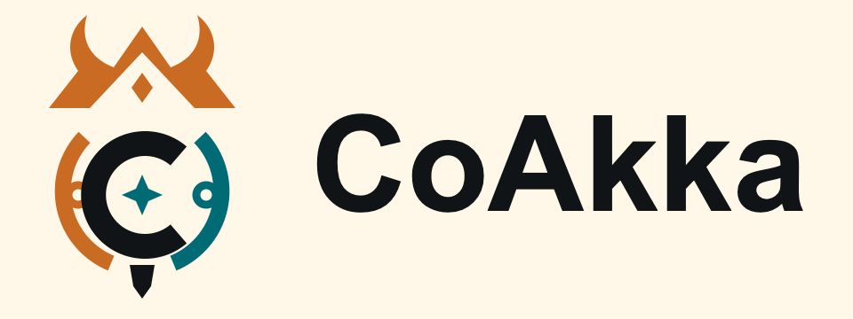

# CoAkka Samples

**Shared native cores. Familiar APIs across languages.**

CoAkka is a **polyglot, cross-platform ecosystem** of **native-backed runtimes**.
Each product has its own native core, shared by that product's language
connectors through familiar APIs.

An application can bring together a web API, a Python worker and an existing
JVM service. CoAkka gives teams shared building blocks for calling application
work, serving HTTP and handling logs across languages. Business logic stays
in the application's own code.

This repository shows those products in small, runnable examples. Choose the
problem you want to solve, then try one example in your language. Each product
can be used independently and has its own packages and version.

| Product | What it helps you do | Start here | First command |
| --- | --- | --- | --- |
| CoAkka Runtime | Connect application-owned work across languages and processes. | [Language samples, tools, addons and demos](coakka-runtime/README.md) | `bash run.sh coakka-runtime list` |
| CoAkka HTTP Runtime | Build HTTP services with shared behavior across languages. | [HTTP server/client examples](coakka-http-runtime/README.md) | `bash coakka-http-runtime/go/run.sh run` |
| CoAkka Logger | Read application logs and observe pressure with bounded storage. | [Logging and pressure examples](coakka-logger/README.md) | `bash run.sh coakka-logger node basic` |

For a two-process Runtime example with Docker, run
`bash run.sh coakka-runtime containers node-python`.
Use `bash run.sh doctor` for prerequisites and `bash run.sh list` for available
examples. Read the selected product guide before installing its package.
Runtime package coordinates do not install HTTP Runtime.

Shared documentation lives in [docs/](docs/README.md):

- [New to CoAkka](docs/common/new-to-coakka.md) and [ecosystem overview](docs/common/ecosystem-overview.md).
- [Current packages](docs/common/current-packages.md) and [package/platform evidence](docs/coakka-runtime/reference/runtime-package-platform-evidence.md).
- [Product layout](docs/common/product-layout.md), [integration guidance](docs/coakka-runtime/guides/ai-assisted-integration.md) and [troubleshooting](docs/coakka-runtime/operations/troubleshooting.md).

Samples is a rolling repository. Exact dependencies and executable checks are
its integration contract. Versioned source mirrors preserve their recorded
contents. Private candidate guides are clearly scoped and do not publish a
package or expand platform support.

[Contributing](CONTRIBUTING.md) · [Support](SUPPORT.md) · [Changelog](CHANGELOG.md)

Contact: `gabrielgun1983@gmail.com`
