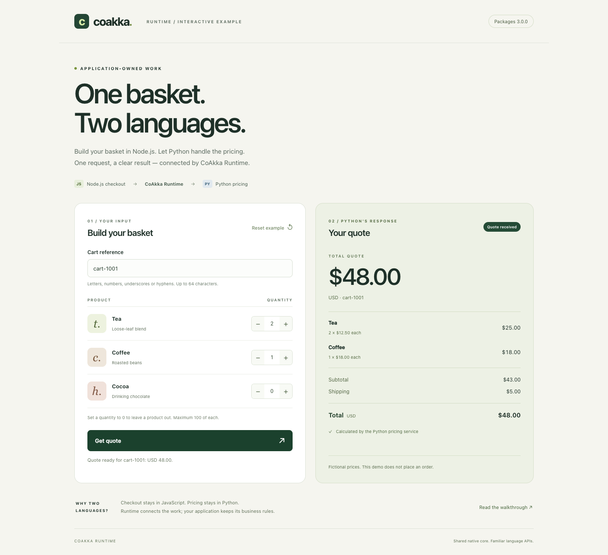

# Node.js Checkout, Python Pricing

**Build a basket in your browser. Get its quote from Python through Node.js.**

A shop may use JavaScript for checkout and Python for its pricing rules. This
example keeps those rules in Python: Node sends a cart to the named work
`samples.order.quote`, and Python returns item prices, shipping and a total.
CoAkka Runtime carries the request and reply between the two processes.
The browser talks to the Node web app; Node asks Python through Runtime.

Both apps use **published 3.2.1 packages** from npm and PyPI. Run them in two
terminals on one computer. Each app starts its own Runtime; no separate Runtime
server, Docker installation or Core build is needed.

The example basket contains two teas and one coffee. Python returns the item
prices, shipping and **USD 48.00** total shown above.

## What you will see

The supplied cart contains two teas and one coffee:

| Item | Quantity | Unit price | Line total |
| --- | --- | --- | --- |
| Tea | 2 | USD 12.50 | USD 25.00 |
| Coffee | 1 | USD 18.00 | USD 18.00 |
| Shipping | | | USD 5.00 |
| **Quote** | | | **USD 48.00** |

These are fictional sample prices. Python charges USD 5 shipping below a
USD 50 subtotal; shipping is free from USD 50. Money is calculated in whole
cents. Nothing is purchased or stored.

## 1. Get the example and install packages

You need **Node.js 22 or later**, npm, and **standard CPython 3.11 or later**.
Use one of the [supported platforms](../../../docs/coakka-runtime/reference/runtime-package-platform-evidence.md).
Python and Node run on the same computer in this walkthrough.

If you already have this repository, use your existing checkout. Otherwise:

~~~sh
git clone https://github.com/phuong-tran/coakka-samples.git
cd coakka-samples
~~~

From the repository root, enter the example:

~~~sh
cd coakka-runtime/scenarios/order-quote-node-python
npm ci
~~~

On **macOS or Linux**:

~~~sh
python3 -m venv .venv
.venv/bin/python -m pip install -r requirements.txt
~~~

On **Windows PowerShell** (the command below selects Python 3.11):

~~~powershell
py -3.11 -m venv .venv
.venv\Scripts\python.exe -m pip install -r requirements.txt
~~~

No environment activation is needed. [package.json](package.json) pins
`coakka-v2-connector-node` to 3.2.1 and [requirements.txt](requirements.txt)
pins `coakka-v2-connector` to 3.2.1. The Node lockfile fixes its resolved package.

## 2. Terminal A: start Python pricing

Stay in the example directory. On macOS/Linux:

~~~sh
.venv/bin/python pricing_service.py
~~~

On Windows PowerShell:

~~~powershell
.venv\Scripts\python.exe pricing_service.py
~~~

Wait for:

~~~text
Pricing service ready at 127.0.0.1:19360
Press Enter or Ctrl+C to stop.
~~~

Keep this terminal open. The ready line appears after Runtime has started and
the pricing handler has been registered. Run one pricing service on this port;
use another port if you start another service.

## 3. Terminal B: request a quote with Node

Open another terminal and enter the **same example directory** in your checkout.
Run this command on macOS, Linux or Windows PowerShell:

~~~sh
npm run web
~~~

Node prints:

~~~text
Open http://127.0.0.1:8080 in your browser.
~~~

Open that address. Change the quantities, then click **Get quote**. The example
basket of two teas and one coffee returns **USD 48.00**, including USD 5 shipping.
The result shows each item, its price, the subtotal, shipping and total returned
by Python. Set a product's quantity to 0 to leave it out.

Try four teas and no coffee for a USD 50.00 quote with free shipping. Changing
any input marks the previous quote as out of date; click **Get quote** again.
While a request is pending, the form is disabled. A rejected cart or unavailable
Python service produces a visible message, without keeping an old price current.
**Reset example** restores the starting basket. The page also works on a narrow
mobile-sized browser window.

Keep both terminals open while using the page. Node owns one Runtime for its web
app lifetime; it does not start Python or calculate prices. Repeated requests
use that same application. Each Node app has a distinct instance name.

### Prefer the terminal?

The original command-line example remains available:

~~~sh
npm run quote
~~~

It prints:

~~~text
Quote cart-1001: USD 48.00
Calculated by the Python pricing service.
~~~

This command-line caller closes its Runtime and exits after one reply. Python
stays available. For the complete result as JSON:

~~~sh
node client.mjs --json
~~~

## Change the cart

In the browser, use the quantity controls and cart reference field.
For the **command-line** example, edit [cart.json](cart.json), then run npm run quote again.
Editing that file does not change the browser form. For example, four
teas give a USD 50.00 subtotal and free shipping. Python also knows `coffee`
(USD 18.00) and `cocoa` (USD 22.00).

A cart needs a short `cartId` and 1–20 items. Each item has `sku` and a whole
`quantity` from 1 to 100. The JSON input is limited to 16 KiB. An unknown product
or invalid quantity receives a normal business reply, such as:

~~~text
Cart rejected: Choose tea, coffee or cocoa.
~~~

To use another cart file:

~~~sh
node client.mjs --cart my-cart.json
~~~

The command-line Node caller exits with 0 for a quote, 2 for a rejected cart and 1 when it cannot obtain
a usable result. A rejected cart means Python answered; an unavailable service
or expired request is a different failure. The demo does not retry a request.

## Stop and run tests

In Terminal A, press **Enter** or **Ctrl+C**. Python closes Runtime and prints
`Pricing service stopped.` For the web app, press **Ctrl+C in Terminal B** too; Node stops accepting web
requests, finishes bounded work and closes its Runtime. The one-shot CLI caller
needs no separate stop command after a quote.

From the example directory, with packages installed:

~~~sh
npm test
~~~

This works in PowerShell too. Tests choose the Python executable in `.venv`;
if you keep your environment elsewhere, set `PYTHON` to that executable.
Tests start and stop their own Python/Node processes on available local ports.
They cover pricing rules, malformed input, concurrent callers, rejected carts,
missing routes/services, request deadlines, interrupted work and clean shutdown.
Only the test fixture simulates slow or failing business work. HTTP tests also
cover input limits, local-page access checks, busy responses and clean shutdown.

For the optional automated browser checks, install the test browser once and run:

~~~sh
npx playwright install chromium
npm run test:browser
~~~

These checks exercise real Python quotes, editing, loading, rejection, keyboard
controls, narrow layout and unavailable-service messages. Playwright is a test-only
dependency; it is not used by the running web app.

## If it does not run

| Symptom | What to check |
| --- | --- |
| Python has no ready line | Confirm its package installation and Python version. Port 19360 may already be in use. |
| The page or CLI says quote unavailable | Start Python first; use the same port in both terminals. Also check that the cart file is readable JSON. |
| Cart is rejected | Read the returned message and correct its product or quantity. |
| You need another Python port | Start Python with `pricing_service.py --port 19361`, then the web app with `node web.mjs --pricing-port 19361` (or CLI with `node client.mjs --port 19361`). |
| Web port 8080 is occupied | Run `node web.mjs --port 8081`, then open the new address printed in Terminal B. |
| Python exits immediately | Keep its terminal input open. End-of-input also stops the service. |

The example listens only on `127.0.0.1`. It teaches two processes on one
computer; open the exact local URL printed by Node. The web edge limits request
size and concurrent work and does not retry quotes automatically. A multi-machine
or public deployment needs its own network, authentication and security setup.

## Read the code and reuse the pattern

| File | Responsibility |
| --- | --- |
| [web.mjs](web.mjs) and [web-server.mjs](web-server.mjs) | Serve the browser UI, forward carts through Runtime and own web-app shutdown. |
| [web/](web/) | Browser form, responsive layout, request states and quote display. |
| [client.mjs](client.mjs) | Read a cart, show the result and choose a CLI exit status. |
| [quote-client.mjs](quote-client.mjs) | Start the Node Runtime, ask Python for a quote and close. |
| [pricing_service.py](pricing_service.py) | Start the Python Runtime and register the pricing handler. |
| [pricing.py](pricing.py) | Validate the cart, apply catalog/shipping rules and return JSON. |
| [Integration tests](tests/integration.test.mjs) | Exercise the actual released packages across processes. |
| [Web tests](tests/web.test.mjs) and [browser tests](tests/browser.test.mjs) | Check the HTTP edge and actual user interactions. |
| [Pricing tests](tests/pricing_test.py) | Check business rules and input boundaries. |

The target is the name of the work, not a process name. Node's route tells
Runtime where Python owns that work; Python registers its handler for the same
target. Each application owns its Runtime lifetime. Runtime owns delivery,
reply matching and request deadlines. Python owns the pricing decision.
Both sides exchange ordinary JSON application data.

AUTO CPU selection, MULTIPLEXED connections and monitoring off remain the
Runtime defaults. The demo configures only its identities, target and local
network address. See [defaults and monitoring](../../../docs/coakka-runtime/operations/runtime-monitoring.md)
when you need to inspect or change those settings.

Next: [integrate Runtime in your app](../../../docs/coakka-runtime/guides/runtime-integration-guide.md)
or [choose another use case](../../../docs/coakka-runtime/guides/examples-and-use-cases.md).
[Runtime samples](../../README.md) · [All products](../../../README.md).
