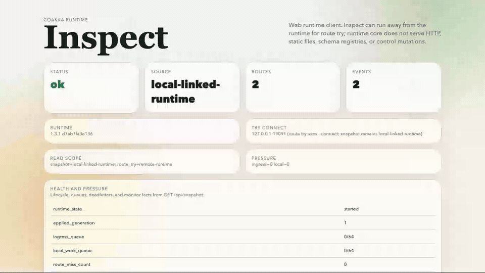

# CoAkka Runtime Inspect Samples

`coakka-runtime-inspect` is the browser runtime explorer for CoAkka Runtime.
It is the visual sibling of `coakka-client`: both point at a caller-supplied
runtime address, both use runtime-owned truth, and both keep route try behavior
aligned with `call` / `ask`.

The native [coakka-runtime-inspect 3.2.1](https://github.com/phuong-tran/coakka-publish/tree/86aa17f3d2af26bfd0faee3c02fbd9e82750592e/coakka-tools/coakka-runtime-inspect/releases/3.2.1%2Bf9e5a632d2d046a5b4e89d5ce0c9042aee5c7b45) archives use Core 3.2.
The sample runner and Docker walkthrough below exercise the 2.5.1 snapshot.

This sample lane can verify the published macOS ARM64, Linux x86_64, Linux
ARM64, Windows x86_64, and Windows ARM64 inspect archives from
`coakka-publish`.



Full recording: [coakka-runtime-inspect.mp4](../../../docs/coakka-runtime/assets/coakka-runtime-inspect.mp4)

Detailed docs live under [docs/](../../../docs/coakka-runtime/tools/coakka-runtime-inspect/):

- [Introduction](../../../docs/coakka-runtime/tools/coakka-runtime-inspect/introduction.md)
- [Usage Guide](../../../docs/coakka-runtime/tools/coakka-runtime-inspect/usage.md)
- [Technical Notes](../../../docs/coakka-runtime/tools/coakka-runtime-inspect/technical-notes.md)

## Quick Check

Run the public sample wiring check:

```sh
bash run.sh coakka-runtime inspect
bash run.sh coakka-runtime inspect check
```

On macOS ARM64, Linux x86_64/ARM64, or Windows x86_64/ARM64, run the published
archive smoke:

```sh
bash run.sh coakka-runtime inspect published-smoke
```

If a sibling native build is available, smoke the real inspect binary:

```sh
bash run.sh coakka-runtime inspect local-smoke
```

To start the browser UI from that local binary:

```sh
bash run.sh coakka-runtime inspect serve
```

To try inspect through Docker without installing the native binary on the host:

```sh
bash run.sh coakka-runtime inspect docker-smoke
bash run.sh coakka-runtime inspect docker-serve
```

`docker-smoke` builds a local image from the published Linux inspect archive and
runs command smoke inside the container. `docker-serve` exposes the browser UI
on `http://127.0.0.1:18080` by default.

For local/native smoke, point the sample at a local inspect binary:

```sh
COAKKA_RUNTIME_INSPECT_BIN=/path/to/coakka-runtime-inspect \
  bash run.sh coakka-runtime inspect local-smoke
```

## Boundary

`coakka-runtime-inspect` is not an admin dashboard, schema registry, service
mesh console, or topology authority. Runtime core owns topology, health,
pressure, route generation, and delivery outcomes. Inspect renders those facts
and provides a browser route-try form that can copy an equivalent
`coakka-client` command.

V1 `serve --connect host:port` configures the route-try request path. Remote
read/observe snapshots are still a future runtime surface; current snapshots
are explicitly labelled `local-linked-runtime`.

## Published Release

Download [coakka-runtime-inspect 3.2.1](https://github.com/phuong-tran/coakka-publish/tree/86aa17f3d2af26bfd0faee3c02fbd9e82750592e/coakka-tools/coakka-runtime-inspect/releases/3.2.1%2Bf9e5a632d2d046a5b4e89d5ce0c9042aee5c7b45) and unpack the archive for your platform.
Run `bin/coakka-runtime-inspect version` on macOS/Linux or
`bin\coakka-runtime-inspect.exe version` on Windows. The command reports Core 3.2.
See the [archive checksums and verification](https://github.com/phuong-tran/coakka-publish/blob/main/docs/coakka-runtime/releases/2026-11-05-runtime-tools-3.2.1.md).

## Docker

The Docker path is a sample convenience wrapper around the published Linux
inspect archive. It is not the canonical artifact download surface and it does
not move HTTP serving into runtime core.

The image copies the published Linux inspect archive as-is. It does not install
native implementation runtime packages; the public native archive itself must
carry that boundary.

Build and smoke the local image:

```sh
bash run.sh coakka-runtime inspect docker-smoke
```

Run the browser UI:

```sh
bash run.sh coakka-runtime inspect docker-serve
```

Override the image tag or host port:

```sh
COAKKA_RUNTIME_INSPECT_DOCKER_IMAGE=coakka-runtime-inspect-sample:local \
COAKKA_RUNTIME_INSPECT_DOCKER_PORT=18081 \
  bash run.sh coakka-runtime inspect docker-serve
```

Run the current public Docker Hub image without preparing a local artifact context:

```sh
bash run.sh coakka-runtime inspect dockerhub-smoke
docker run --rm docker.io/gabrielgun1983/coakka-runtime-inspect-sample:2.5.1-26f7944d-remote
```

Serve the browser UI from Docker Hub:

```sh
bash run.sh coakka-runtime inspect dockerhub-serve
docker run --rm -p 18080:18080 docker.io/gabrielgun1983/coakka-runtime-inspect-sample:2.5.1-26f7944d-remote serve
```
