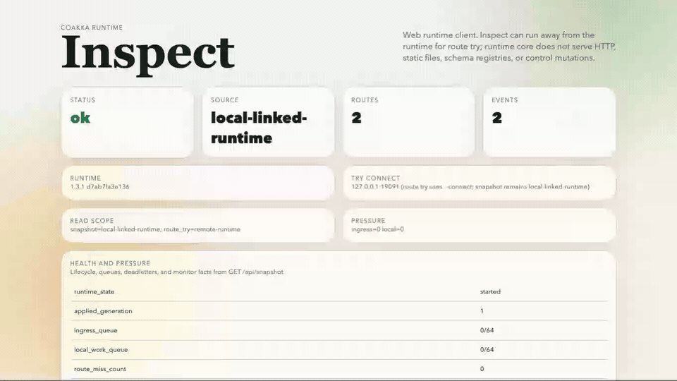

# CoAkka Runtime Inspect

**CoAkka Runtime Inspect** (`coakka-runtime-inspect`) is the browser explorer
and request/reply trial tool for CoAkka Runtime. It is the visual companion to
[CoAkka Runtime Client](coakka-runtime-client.md), whose published command is
`coakka-client`.

Inspect shows the source of each snapshot. A snapshot from the Runtime
linked into Inspect is labeled `local-linked-runtime`. The destination of
a trial request and the source of a displayed snapshot can differ.



Full recording: [coakka-runtime-inspect.mp4](../assets/coakka-runtime-inspect.mp4)

Use inspect when a user needs to see runtime facts in a browser:

- runtime identity
- route catalog
- endpoint topology
- effective connection strategy, defaults revision, and tuning provenance
- runtime feature availability, including independent File Lane and Stream Lane
  support when reported
- effective capability masks and non-secret TLS/mTLS state
- health and pressure state
- recent runtime events
- a route-try form for request/reply experiments
- a copied equivalent `coakka-client` command from the browser form

It is not an admin dashboard, observability platform, schema registry, service
discovery server, mTLS control plane, or topology authority. Runtime core
remains the source of truth; inspect reads and renders runtime facts.

The transport section reports the settings of the displayed snapshot.
TLS credential contents, private keys, and credential paths stay private.
When certificate identity metadata is available, inspect shows only non-secret
fields such as credential ID and generation, validity bounds, and fingerprint.

Inspect reports lane availability only. Active File Lane and Stream Lane
sessions remain application-owned; the UI does not invent active-session facts
that the runtime snapshot does not expose.

## How It Differs From Swagger

Swagger and OpenAPI describe HTTP APIs: paths, methods, request/response
schemas, status codes, auth, and API docs.

`coakka-runtime-inspect` describes runtime targets and runtime delivery:

```text
target -> route snapshot -> endpoint -> reply, timeout, or deadletter
```

The goal is not to clone Swagger for HTTP. The goal is to make runtime-owned
targets, routes, pressure, and outcomes visible when the system is using CoAkka
for application-owned work behind or beside the HTTP edge.

## Published Artifacts

Download [coakka-runtime-inspect 3.2.1](https://github.com/phuong-tran/coakka-publish/tree/86aa17f3d2af26bfd0faee3c02fbd9e82750592e/coakka-tools/coakka-runtime-inspect/releases/3.2.1%2Bf9e5a632d2d046a5b4e89d5ce0c9042aee5c7b45) for macOS ARM64, Linux ARM64/x64, or
Windows ARM64/x64. The tool bundles Core 3.2 (ABI 1). The
[release record](../releases/2026-11-05-runtime-tools-3.2.1.md) lists checksums and installed test scope.

The sample runner commands below exercise the pinned 2.5.1 walkthrough.
For the native 3.2.1 build, unpack the archive and run the executable
from its package directory.

## Sample Entry Points

In `coakka-samples`, use:

```sh
bash run.sh coakka-runtime inspect check
bash run.sh coakka-runtime inspect published-smoke
bash run.sh coakka-runtime inspect serve
bash run.sh coakka-runtime inspect docker-smoke
bash run.sh coakka-runtime inspect docker-serve
bash run.sh coakka-runtime inspect dockerhub-smoke
```

For the Docker Hub zero-install path:

```sh
docker run --rm docker.io/gabrielgun1983/coakka-runtime-inspect-sample:2.5.1-26f7944d-remote
```

To serve the browser UI from the Docker Hub sample image:

```sh
docker run --rm -p 18080:18080 docker.io/gabrielgun1983/coakka-runtime-inspect-sample:2.5.1-26f7944d-remote serve
```

The multi-architecture image digest is
`sha256:8dae4f4f392a83a2cbbc4d6d4e15b39ad4186996a469d36a11e0992334329ac3`.

## Relationship To coakka-client

`coakka-runtime-inspect` is read-first visual exploration.
`coakka-client` is script-first terminal tooling.

Both should preserve the same request metadata shape and explicit terminal
outcomes: reply, timeout, deadletter, and configuration error.

`coakka-client runtime-info` reads the same bounded runtime snapshot for
scripts; inspect renders that runtime-owned truth for interactive diagnosis.

For the terminal tool, read [CoAkka Runtime Client](coakka-runtime-client.md).
