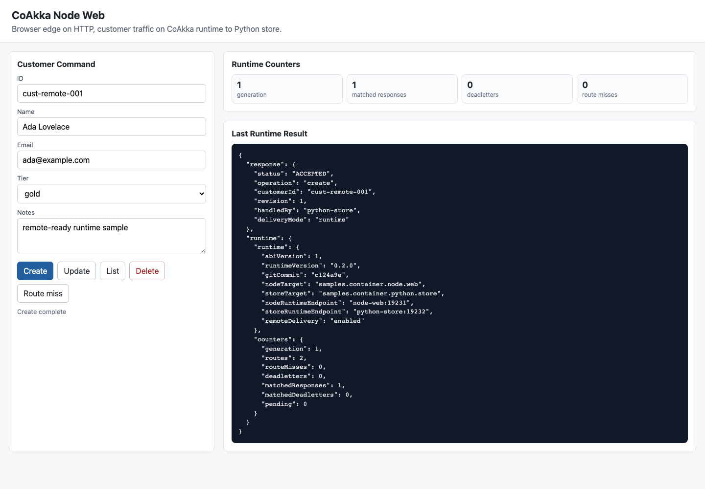
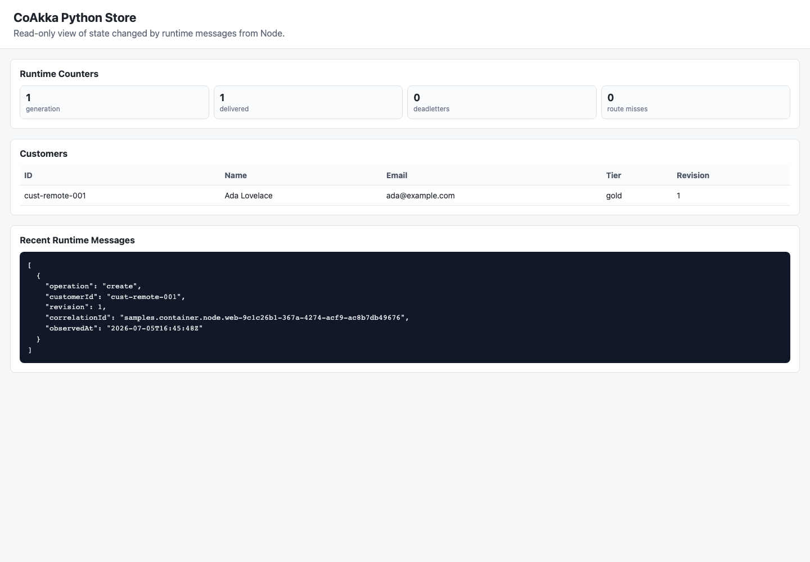

# Production Evidence

For current installation, use the [package ledger](../../common/current-packages.md),
[Runtime changelog](../CHANGELOG.md) and [language-first examples](../getting-started.md).
The campaign rows below retain their named versions and scope; an older row
does not describe the latest package or prove a newer sample ran.

This page is the **CoAkka Runtime and Logger** evidence ledger for the public
sample repository. HTTP server/client evidence is recorded separately in the
[HTTP Runtime sample scope](https://github.com/phuong-tran/coakka-samples/blob/main/coakka-http-runtime/README.md#verify-a-change)
and [HTTP benchmark results](https://github.com/phuong-tran/coakka-publish/blob/main/coakka-http-runtime/benchmark/README.md).

The
samples show that the published artifact surface is runnable and that the
runtime vocabulary stays consistent across languages. Capacity, SLO, and
operator-acceptance claims are attached to the target environment where the
runtime path will operate.

## Current Evidence

| Area | Public evidence today | How to run |
| --- | --- | --- |
| Container runtime path | Node.js web to Python store runs as separate processes with browser-visible state and no store REST fallback; screenshots are committed under `docs/assets/`. | `bash run.sh coakka-runtime containers node-python` |
| Local request/reply | JVM, Python, Node.js, Go, C#, Rust, native C/C++, Mojo, and Zig basic runtime samples. | `bash run.sh coakka-runtime <language> basic` |
| Route miss and deadletter | JVM, Java, Python, Node.js, Go, native C/C++, Mojo, and Zig samples expose route-miss/deadletter behavior. | `bash run.sh coakka-runtime jvm deadletter`, `bash run.sh coakka-runtime python deadletter`, `bash run.sh coakka-runtime native basic` |
| Route reload | Python demonstrates the connector path. The public native C11 harness alternates full route snapshots across quota-gated concurrent traffic, observes every accepted generation as active before releasing the next traffic slice, proves active/replaced target outcomes, and rejects stale or invalid generations without mutating final state. This means route-snapshot reload, not TLS credential reload. | `bash run.sh coakka-runtime python hot-reload`; `bash coakka-runtime/coakka-runtime-test/run.sh hot-reload` |
| Queue pressure | Native C pressure sample verifies bounded queue rejection and deadletter counters. | `bash run.sh coakka-runtime native pressure` |
| Native public-ABI evidence | Repeatable smoke, pressure, stress, and soak scenarios enforce route, terminal-outcome, reply, deadletter, and bounded-admission invariants and emit one machine-readable JSON result. Prefer controlled Linux for deployment-oriented measurements; macOS, Windows, CI, Docker, and VM runs are portability evidence. | [Run a published smoke test](https://github.com/phuong-tran/coakka-publish/blob/main/coakka-runtime/coakka-runtime-test/README.md#run-the-historical-published-smoke-test) |
| Native connection-strategy contract | Public C source checks all four modes against effective capabilities, structured atomic apply/rejection, invalid-apply rollback, complete startup lifecycle, and post-start immutability. Its JSON explicitly excludes active TLS/mTLS certificate exercise. | [CoAkka Runtime Test](https://github.com/phuong-tran/coakka-publish/tree/main/coakka-runtime/coakka-runtime-test). |
| Native concurrency contract | Public C11 source releases concurrent producers against one runtime, requires exactly one reply or explicit queue-pressure deadletter per admitted request, rejects unexplained terminal outcomes, verifies submit-versus-stop convergence on `CLOSED`, and contends independent complete runtime lifecycles. Small CI profiles are portability gates; thread count, request count, lifecycle iterations, queue capacity, and timeout remain configurable for deeper evaluation. | `bash coakka-runtime/coakka-runtime-test/run.sh race --threads 4 --requests 256` |
| Native file-transfer contract | Public C11 source exercises a `9 * 1024 * 1024 + 731` byte multi-quantum loopback transfer through only the File Lane C ABI and checks SHA-256, durable receiver completion, progress, and counters. The Simple profile remains supported; the Owner-aware profile additionally verifies exact owner projection and grant handoff against the sealed `2.5.0+4b65d0b2` candidate without claiming publication. | `bash coakka-runtime/coakka-runtime-test/run.sh file-lane-simple`; `bash coakka-runtime/coakka-runtime-test/run.sh file-lane-owner-aware` |
| Artifact-source addons | Eleven native addons at `1.1.0+d1032f6d` and SFTP replacement `1.2.0+88b9a047` expose exact reviewed 11-symbol C ABIs. The released implementations carry bounded lifecycle, cancellation, timeout, integrity/no-clobber, fault, resource-recovery, and platform evidence. Public samples independently consume the archives and require publisher/sender plus receiver `COMPLETED + OK`. Deterministic fixtures are not live provider certification. | `bash run.sh coakka-runtime addons all published` |
| Native streaming contract | Public C11 source transfers 97 ordered variable-size frames and verifies metadata, source-reported drops, pressure, waits, counters, terminal state, forget, and stop through only the Stream Lane C ABI. The Owner-aware profile adds exact publisher projection and single-admission grant handoff. | `bash coakka-runtime/coakka-runtime-test/run.sh stream-lane-simple`; `bash coakka-runtime/coakka-runtime-test/run.sh stream-lane-owner-aware` |
| Sanitizers | Consumer-only ASan/UBSan and TSan controls are available from the public harness. A Core sanitizer claim requires the exact recorded runtime source generation and harness to be instrumented in one build; ordinary production binaries are never described as implicitly instrumented. Hosted CI does not run these expensive profiles. | See [the Runtime test guide](https://github.com/phuong-tran/coakka-publish/tree/main/coakka-runtime/coakka-runtime-test); run sanitizer profiles explicitly on a controlled local or evaluator host. |
| Logger pressure | JVM, Java, Python, Node.js, Go, C#, Rust, and native logger pressure samples verify bounded logging rejection and dropped counters. | `bash run.sh coakka-logger <language> pressure` |
| Artifact pins | Public samples resolve pinned public artifacts and validate SHA256 rows. | `bash scripts/check-artifact-pins.sh` |
| Runtime tools | Client and Inspect 3.2.1 archives bundle Core 3.2. Connected installed checks cover macOS ARM64, Pi 5, WSL2 x64, physical Windows x64 and Windows ARM64 UTM. | [Runtime tools 3.2.1](../releases/2026-11-05-runtime-tools-3.2.1.md) |
| Current package execution | Runtime 3.2.1 is published on npm, PyPI, NuGet, Maven Central, GitHub and SwiftPM. Consult the release record for the exact package, Core build, host and workload. | [Runtime 3.2.1 release records](../CHANGELOG.md#321) · [Current Packages](../../common/current-packages.md) |
| Android preview | The standalone 3.2.1 AAR passed installed emulator and lifecycle tests on API 24 x86_64 and API 36 ARM64. API 24 ARM64 stopped before APK installation. | [Android preview evidence](../releases/2026-11-05-android-runtime-3.2.1-preview.md) |
| Historical package execution | The earlier Runtime 2.5.3 registry packages, Go v1.8.3 and SwiftPM v2.5.3 used Core 2.5.1. Their results apply to those exact packages. | [Runtime 2.5.3 release evidence](../releases/2026-08-21-runtime-registries-2.5.3.md) |
| CI smoke | GitHub Actions checks entrypoints, artifact pins, quickstart, selected logger samples, and selected runtime samples. | `.github/workflows/sample-smoke.yml` |
| Manual smoke-load | Workflow-dispatched benchmark smoke emits validated JSON for selected profiles. | `.github/workflows/bench-smoke.yml` |

## Visual Evidence

The Node.js web to Python store container sample is verified from the published
multi-arch image path:

```sh
bash run.sh coakka-runtime containers node-python up -d
bash run.sh coakka-runtime containers node-python smoke
```

Screenshots:





The web screenshot shows an accepted create command and runtime counters. The
store screenshot shows the same customer state changed by runtime messages from
the web process.

## Deployment Evidence To Collect Per Environment

Collect these areas per deployment profile:

- sustained cross-process load under realistic Linux memory and CPU limits
- peer restart and reconnect behavior across long-running workloads
- route reload under concurrent cross-process traffic
- latency envelopes across operating systems, CPU classes, and container
  runtimes
- durable memory profile under multi-hour or multi-day service operation
- operator dashboards, alerts, and incident runbooks
- package-manager lanes for Mojo and Zig

## Evidence Checklist For A Deployment

When a service standardizes on this runtime path, collect evidence in the
target environment:

| Check | Required observation |
| --- | --- |
| Linux/container baseline | Same sample or service path runs under the target container runtime and resource limits. |
| Load and queue pressure | Queue depth, rejection, deadletter, timeout, and matched-reply counters stay explainable under burst traffic. |
| Restart | A participant restart fails closed, recovers cleanly, and does not duplicate business ownership. |
| Reconnect | Peer or transport interruption produces visible runtime outcomes and then resumes on a healthy route. |
| Route reload | Newer route generations apply; stale generations are rejected; invalid snapshots do not replace the active table. |
| Memory | Resident memory and queue sizes stay within the service budget under steady load. |
| Retry policy | User retries remain application policy and do not amplify runtime pressure blindly. |
| Artifact loading | Native libraries load from the same package layout used in deployment. |
| Observability | Logs/metrics include target, source, generation, node identity, route miss, timeout, deadletter, and queue pressure counters. |

## Benchmark Policy

Benchmarks are useful only when the metadata travels with the number. Public
sample benchmark artifacts must record:

- repository commit
- public artifact generation
- OS and CPU
- container or host runtime and exact API/workload/payload shape
- Core-reported effective CPU policy/count and connection strategy; a requested
  preference is not proof of its application
- queue capacity and `strictNoDrop`
- warmup and measured repetitions
- aggregation rule and both throughput and tail latency
- thermal start threshold and actual start temperature, throttling and governor
  observations where relevant; RPi performance windows start below 50°C
- steady/peak RSS, allocation churn, thread/fd growth, wakeups/syscalls and
  cancellation/stop behavior appropriate to the changed boundary
- whether the result is only a smoke-load reference

Benchmark artifacts are supporting evidence, not the main product positioning.
CoAkka Runtime's primary claim is the runtime capability boundary: target ownership,
route snapshots, bounded delivery, replies, deadletters, and diagnostics for
application-owned work.

Benchmark comparisons should stay at the transport-backed runtime delivery boundary. CoAkka
Runtime is not an L7 HTTP/gRPC framework benchmark; do not frame its numbers as HTTP/gRPC
replacement claims. Compare route lookup, bounded admission, framing, delivery
outcome, reply matching, deadletter behavior, and queue pressure under the same
payload and transport profile.
If no same-class runtime comparator exists, use benchmark artifacts for CoAkka
release regression and deployment-profile capacity evidence.

The current `bench-smoke` workflow is a shape check. Treat its JSON output as
public CI evidence, not as a substitute for target-environment capacity work.

## Current Reading Order

1. [Run one published example in your language](../getting-started.md).
2. [Choose a business use case](../guides/examples-and-use-cases.md).
3. Read the [integration guide](../guides/runtime-integration-guide.md) when moving it into your application.
4. Add failure/pressure observations using the exact selected package's API.
5. Use this page for deployment evidence; older container demonstrations keep their original versions.
