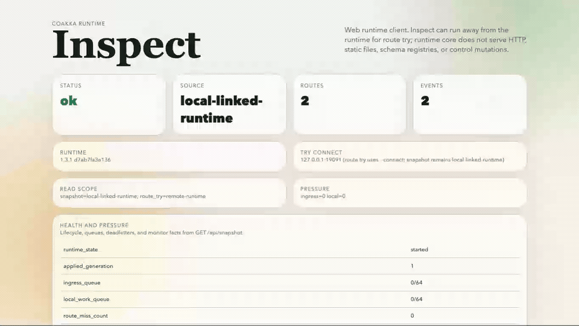

# CoAkka Runtime Inspect Docs

`coakka-runtime-inspect` is the browser-facing runtime explorer lane for
CoAkka Runtime.



Full recording: [coakka-runtime-inspect.mp4](../../assets/coakka-runtime-inspect.mp4)

- [Introduction](introduction.md)
- [Usage Guide](usage.md)
- [Technical Notes](technical-notes.md)

Use these docs together with the local sample runner:

```sh
bash run.sh coakka-runtime inspect check
bash run.sh coakka-runtime inspect published-smoke
bash run.sh coakka-runtime inspect local-smoke
bash run.sh coakka-runtime inspect docker-smoke
bash run.sh coakka-runtime inspect docker-serve
```
