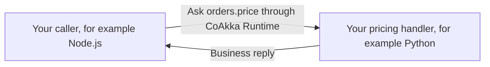

# New To CoAkka

**Start with one piece of application work, in a language you already know.**

Imagine an application that accepts an order. A Node.js API receives the
request, Python calculates a price, and a JVM service owns customer records.
CoAkka Runtime lets the application call that work by a stable name and receive
a reply. The application still owns validation, calculations and business data.

That is **application-owned work**: work belonging to your application even
when the code runs in another process, language or host. CoAkka Runtime is a
polyglot, native-backed distributed runtime for connecting that work.

The order example explains the model; choose a runnable example below to see
which process and language combination that example actually demonstrates.

Each application starts Runtime through its own language package. A call
between applications can look like this:

## Choose the job first

| What are you building? | Start with |
| --- | --- |
| Calls between application handlers, processes or languages | [CoAkka Runtime](../coakka-runtime/getting-started.md) |
| An HTTP API, web frontend or streaming endpoint | [CoAkka HTTP Runtime](../coakka-http-runtime/getting-started.md) |
| Application logging with bounded storage and visible pressure | [CoAkka Logger](../coakka-logger/README.md) |

Each product has its own packages and version. You can adopt one on its own.
An application can also receive an HTTP request, ask Runtime to perform work
and record an event through Logger.

## Try Runtime in your language

[Choose your language](../coakka-runtime/getting-started.md), install its
published package and run one small example. Java and Kotlin have separate
commands; Node.js, Bun, Electron, Python, C#, Go and Swift have their own source.

The first example starts one local Runtime, registers a handler, sends one
request and closes. It proves that your package and application can exchange
a request and reply. It does not require Docker or Kubernetes.

Then [choose a use case](../coakka-runtime/guides/examples-and-use-cases.md):
a customer operation, a framework application, files or streams. Each example
states whether it uses a released package, a local evaluation or an older
demonstration.

## Read the code with four questions

1. **What work has a name?** A target such as orders.price names the operation.
2. **Who handles it?** Your application registers an ordinary function or method.
3. **Who calls it?** Another part of the application submits a request and handles
   the reply or failure.
4. **When does it close?** The application stops Runtime when its work is done.

Language APIs differ so the code feels natural in each host. The application
responsibilities stay the same. Start with the real source for your language
rather than translating a Kotlin or Java example line by line.

## Find the right repository

| Repository | Use it for |
| --- | --- |
| [Samples](https://github.com/phuong-tran/coakka-samples) | Run examples and read application code. |
| [Publish](https://github.com/phuong-tran/coakka-publish) | Find packages, platform requirements and versioned downloads. |

The [package ledger](current-packages.md) records released versions.
The [product map](product-layout.md) explains the repository layout.

## Continue when you need it

- [Move the example into an application](../coakka-runtime/guides/runtime-integration-guide.md).
- [Understand the application model](../coakka-runtime/explanation/coakka-story.md).
- [Grow from one process to several](../coakka-runtime/explanation/startup-development-path.md).
- [Understand defaults and turn on monitoring](../coakka-runtime/operations/runtime-monitoring.md).
- [Troubleshoot a failed first run](../coakka-runtime/operations/troubleshooting.md).
